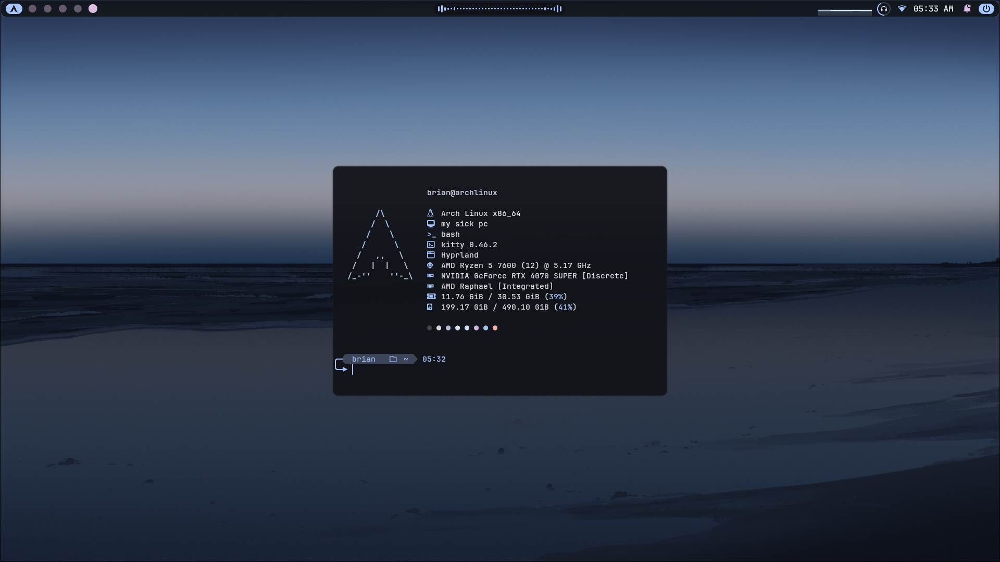
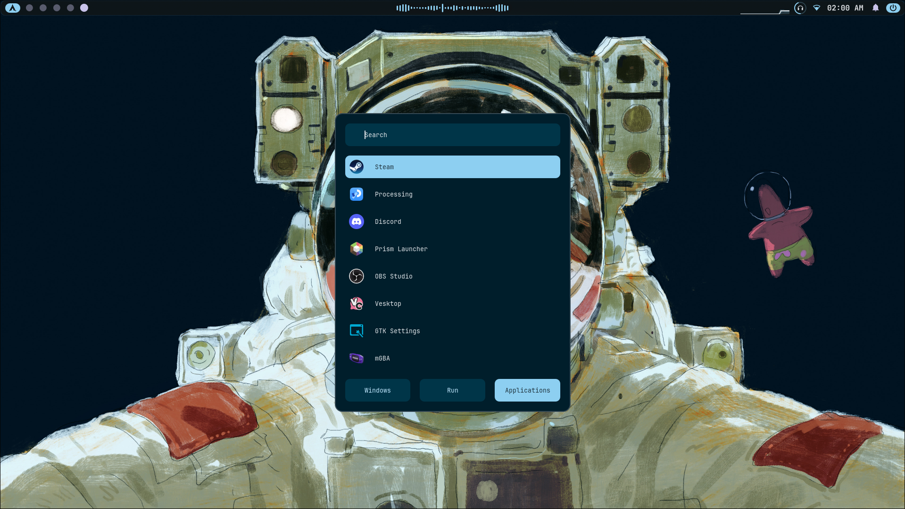

# dotfiles


Personal Arch and Ubuntu dotfiles for a Hyprland-based desktop environment.
Managed with two scripts that sync configs between the live system and this repo.
The setup is built around **matugen**, a material design color generator that
derives a full color palette from the current wallpaper. Every component
pulls from this palette, so the entire shell recolors itself automatically when the
wallpaper changes.

## Screenshots

| Desktop | Terminal |
|--------|--------|
|  |  |

| Rofi | Notifications |
|--------|--------|
|  |  |

## Stack

| Category | Tool |
|----------|------|
| WM | Hyprland |
| Terminal | Kitty |
| Shell | Fish |
| Editor | Neovim |
| Bar | Quickshell |
| Notifications | Swaync |
| Launcher | Rofi |
| Browser | Zen |
| Theming | Matugen |
| Bootloader | GRUB |

## Setup

### Fresh install

Install Bash, Git, and rsync before you run the sync scripts.
The scripts do not install packages.
Clone the repo and select the branch for your machine in lazygit before you run
the apply script:

| Machine | Branch |
|---------|--------|
| Arch desktop | `desktop` |
| Arch laptop | `arch-laptop` |
| Ubuntu laptop | `ubuntu-desktop` |

Create the `arch-laptop` branch before you use these scripts on the Arch laptop.

```bash
git clone https://github.com/brian-brow/dotfiles.git ~/dotfiles
cd ~/dotfiles
chmod +x sync_from_repo.sh
./sync_from_repo.sh
```

The script asks which machine this is and stops if its branch does not match.
It can pull the latest files before it shows the proposed file changes and deletions.
Confirm the preview to apply the files.

Both scripts use `sync_files.sh` for the paths to sync. Each branch can keep its own list.

### Saving changes

After you edit files on your system, run the save script from inside the repo.
It shows the proposed file changes and deletions before it copies files.
It does not stage, commit, or push changes.

```bash
cd ~/dotfiles
./sync_to_repo.sh
```

### Applying configs

To apply the repo configs to your live system:

```bash
cd ~/dotfiles
./sync_from_repo.sh
```
